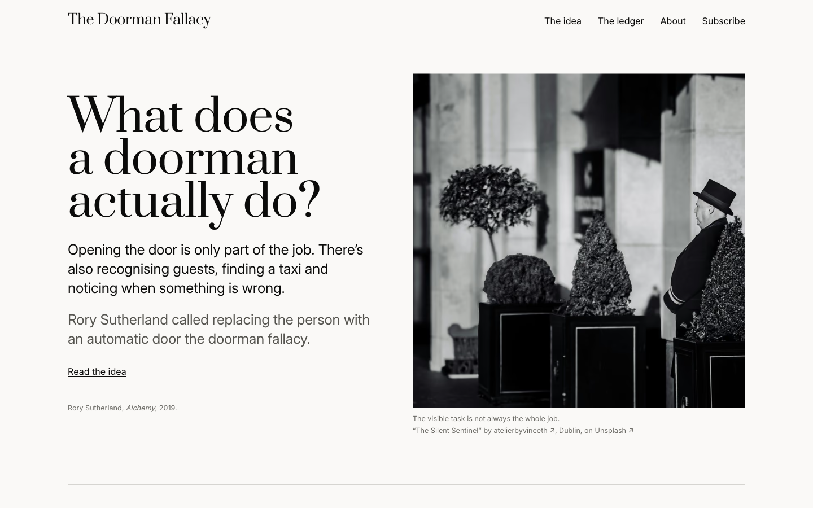

# The Doorman Fallacy



**What else was the person doing?** [TheDoormanFallacy.com](https://thedoormanfallacy.com) explains Rory Sutherland's doorman fallacy and keeps a sourced ledger of what happened after organisations cut roles because AI was to do the work.

A hotel that replaces its doorman with an automatic door saves the cost of opening a door. It loses what the doorman also did: recognising guests, deterring trouble, finding taxis, noticing when something is wrong. The ledger follows real cases of the same decision with AI, and keeps following them. Cuts that hold up are recorded as faithfully as cuts that are reversed.

## How a case is kept

AI agents find, write and check cases, and no person reviews a case before it goes live. Fixed checks take that place, and the strictest one needs no model at all: every factual sentence ends with a footnote holding a sentence copied by code from the source, and that sentence must appear word for word on the source's Wayback Machine copy.

From the first case, built from DNB's own stock exchange release:

```md
## The change

DNB said the changes entail a reduction in the workforce of about 400 full-time equivalents.[^dnb-release-4]

[^dnb-release-4]: "The changes entail a reduction in the workforce of about 400 full-time equivalents (FTEs)."
```

The writing agent never types a quote. It cites sentences by number, code copies them in, and [Jev](https://typesafe.ai) checks each statement against its sentence and the source's details. A statement that says more than its source, or suggests a motive, goes back to the writer once and is then removed. Without a supported update, a case is not published at all.

## The desk

Each week the desk follows up every case and looks for new ones, cheapest stage first. Most AI layoff news is not a doorman case: many cuts fund AI investment, and AI does not take over the cut roles' work.

| Stage | Who | Cost |
|---|---|---|
| Read readers' suggestions and error reports | Code | Free |
| Sweep news searches | Code | A fraction of a cent per search |
| Triage each headline | Jev | Fractions of a cent per lead |
| Rank by doorman priority | Code | Free |
| Assess the strongest leads | An AI agent | About $0.03 per organisation |
| Write the case | An AI agent | About $0.07 per case |
| Check every statement | Jev and code | Under $0.001 per case |
| Review every case for news since its last check | An AI agent, Jev and code | $0.02 to $0.10 per case |

A review adds what was reported since the last check, under the same checks as a new case, and new material needs one primary source or two independent reports of its own. A correction's words are written by code, never by a reader or a model. Every paid call goes through one budget per run, $3 a week. [docs/desk.md](docs/desk.md) has the design and what the runs showed.

## Run it

Needs Node 26 (`.nvmrc`).

```sh
npm ci             # also points git at .githooks, so pushes run the checks
npm run dev        # the site on localhost
npm run check      # types, lint, unit tests, copy, docs and case checks
npm run build      # the static site into dist/
npm run test:site  # browser checks against dist/
```

The desk needs Claude Code, a DeepSeek key, a TypeSafe key and archive.org keys in the macOS Keychain, and a Wrangler login to read readers' suggestions:

```sh
node desk/sweep.ts --size full --days 30 --sources gnews,gdelt,hn,deepseek --budget 0.30
node desk/assess.ts --top 4 --budget 1.50
node desk/draft.ts --assessment .desk-runs/<run>/assessments/<org>.json --publish
node desk/review.ts --case cba-2025 --due --publish   # follow up one case
node desk/weekly.ts --budget 3   # every stage, as the Monday schedule runs it
```

## Where things are

[CLAUDE.md](CLAUDE.md) is the brief: the hard rules and where everything lives. The design, the case format, every rule with the check that enforces it, and the decision log are in [docs/](docs/).

## Contributing

Suggestions of cases and corrections go through the site. Code and design changes are welcome: see [CONTRIBUTING.md](CONTRIBUTING.md).

## Licence

- Code: [MIT](LICENSE).
- The ledger's cases and the site's text: [CC BY 4.0](LICENSE-CONTENT). Reuse them with credit to The Doorman Fallacy.
- Photographs: the [Unsplash licence](https://unsplash.com/license), credited to their photographers below.

## Credits

The doorman fallacy is Rory Sutherland's idea, from *Alchemy* (2019). Photographs by [atelierbyvineeth](https://unsplash.com/@atelierbyvineeth) and [Maryam Tello](https://unsplash.com/@tellophotography). Curated by Jan Hallvard Larsen.

## Support

If the ledger is useful to you, you can [buy me a coffee](https://buymeacoffee.com/jahala).
